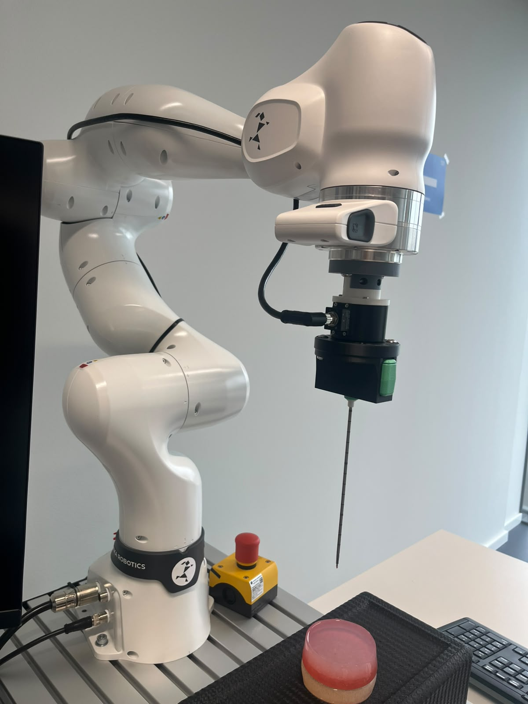
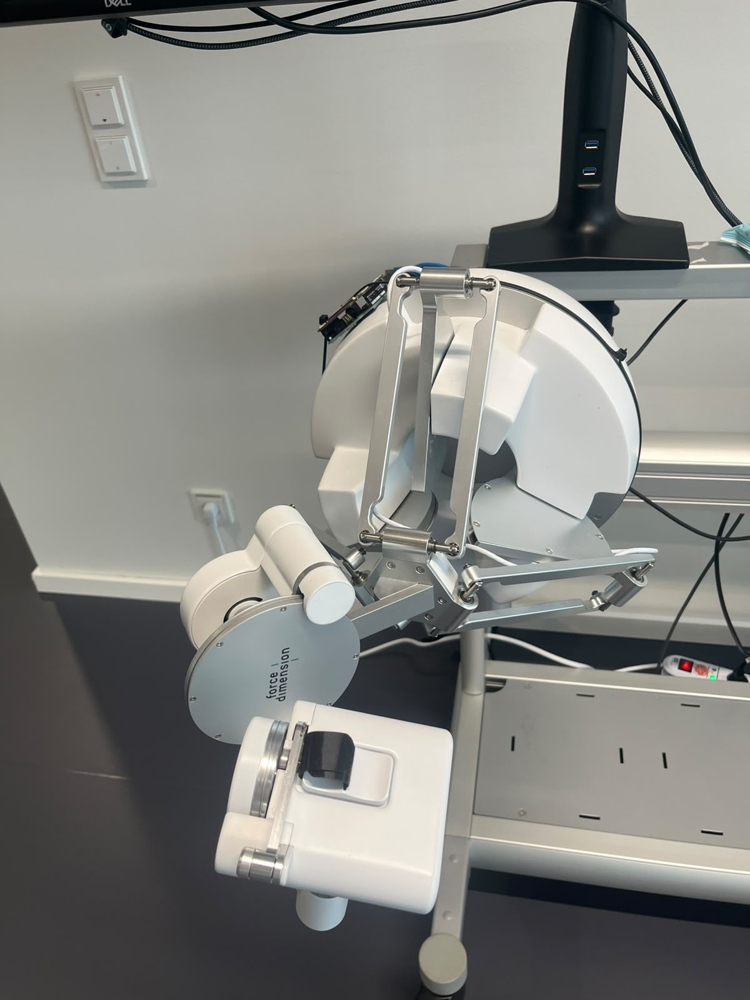

# Multimodal Haptic Teleoperation for Needle Insertion

> **Status: early stage / work in progress.** No code released yet.

A teleoperation setup in which an operator moves a Force Dimension haptic
device by hand and a Franka robot arm carrying a needle follows the motion.
The project adds multimodal feedback (haptic, vibration, audio, tongue-based
tactile) so the operator can perceive what the needle is doing.

  
  

## Hardware
- Franka robot arm with force/torque sensor and needle
- Force Dimension haptic device
- 

## Software
C++, ROS [2], ...

## Context
Developed at HEX lab, TUM.
